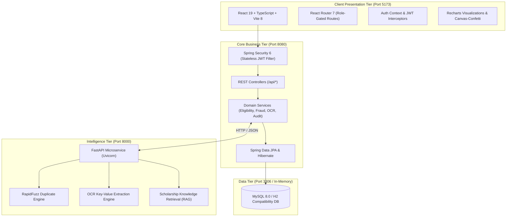

# ScholarTrack System Architecture

## 1. High-Level Design

ScholarTrack is an academic decision-support platform designed to handle the end-to-end lifecycle of scholarship discovery, pre-eligibility filtering, application processing, AI-assisted document verification (OCR), cross-application duplicate detection, and composite fraud risk scoring.

---

## 2. Core Modules & Boundaries

### A. Authentication & Role-Based Access Control (RBAC)
- Stateless authentication using industry-standard JSON Web Tokens (`jjwt` 0.12.6).
- Two authenticated roles:
  - **`ROLE_STUDENT`**: Restricted to their own profile, document uploads, eligibility pre-checks, scholarship applications, and personal notifications.
  - **`ROLE_ADMIN`**: Authorized for application review dossiers, approval/rejection decisions, duplicate triage, fraud flags, scheme creation, and immutable compliance audit logs.
- CORS configured for secure single-origin proxying during development.

### B. Deterministic Eligibility Engine
- Executes rule-based predicate evaluation before an application can be submitted:
  - Minimum qualifying marks check (CGPA / Percentage).
  - Maximum annual family income cap.
  - Social category eligibility (SC/ST/OBC/EWS/General).
  - Gender requirements (Women in STEM schemes).
  - Domicile state requirements.
- Returns clear explainability breakdowns highlighting passed criteria, failed criteria, and missing fields.

### C. AI-Assisted Document Processing & OCR Simulation
- Accepts uploaded PDF, PNG, or JPG files (Income Certificates, Academic Marksheets, Caste Certificates, ID cards).
- Simulates advanced Optical Character Recognition (OCR) to extract verified values:
  - Annual income stated on revenue officer certificates.
  - Percentage/CGPA declared on board/university marksheets.
  - Applicant full name and identification hashes.
- Flags **Discrepancy Severity**:
  - `LOW`: Income delta < 5%, marks delta < 1%.
  - `MEDIUM`: Income delta 5%–15%, marks delta 1%–3%.
  - `HIGH`: Income delta > 15%, marks delta > 3%, or name mismatch.

### D. Duplicate Detection Engine (RapidFuzz)
- Uses fuzzy string matching and token sort algorithms over:
  - Aadhaar number hashes.
  - Bank account numbers and IFSC codes.
  - Student names (handling phonetic differences, initials, and spacing).
  - Phone numbers.
- Alerts administrators if cross-application similarity exceeds 80%.

### E. Decision-Support & Human-in-the-Loop Philosophy
- Automated algorithms output **assistive indicators only**.
- No application is auto-rejected or auto-approved by algorithm.
- Authorized administrative officers must review side-by-side evidence before confirming decisions.
- Every state transition is recorded in the immutable audit log table.
